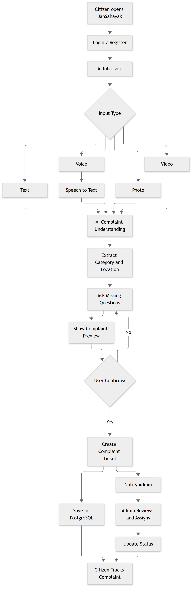
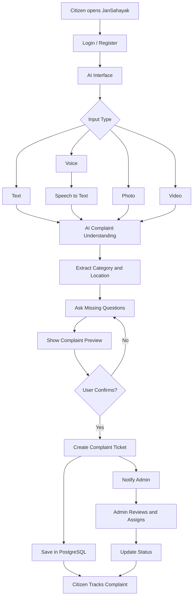

# JANSAHAYAK AI — From Voice to Resolution
**Autonomous Multilingual Complaint Management Platform**

JanSahayak AI empowers citizens to report civic grievances through speech, multilingual text (Hindi, Marathi, Hinglish, English), photos, and video evidence. The platform automatically extracts problem category, SLA urgency, and location, checks duplicate reports, coordinates municipal department dispatch, and tracks verified photo resolution.

---

## 🎨 Design System & Color Palette
- **Charcoal**: `#17191D`
- **Copper**: `#A94D37`
- **Off-white**: `#F7F7F5`
- **Success Green**: `#25845B`
- **Typography**: Clean modern sans-serif with high contrast hierarchy

---

## 🏗️ Architecture & Modules

### End-to-End System Flowchart

<p align="center">
  
</p>

<details>
<summary><b>Click to view Mermaid Diagram Source Code</b></summary>



</details>

### 1. Backend (`/backend`)
- **Framework**: Python Django, Django REST Framework, SimpleJWT
- **Database**: SQLite (Ready for PostgreSQL swap via `.env`)
- **AI Engine**: Multilingual Gemini API integration (`google-genai` 3.6.1) with rule-based fallback heuristic engine for Hindi, Marathi, Hinglish, and English
- **Pre-configured Departments**:
  1. Solid Waste Management (SWM)
  2. Water Supply & Sewerage (WSS)
  3. Roads & Traffic Infrastructure (RTI)
  4. Electrical & Street Lighting (ESL)
  5. Stormwater & Drainage (SWD)
  6. Traffic & Encroachment Control (TEC)

### 2. Frontend (`/frontend`)
- **Framework**: Next.js 16 (App Router) + TypeScript + Tailwind CSS
- **Portals**:
  - **Landing Page (`/`)**: Overview, live statistics, civic verticals & autonomous workflow
  - **Voice & AI Report (`/report`)**: Speech recognition (Web Speech API) + Gemini AI multilingual understanding + editable draft confirmation
  - **Citizen Portal (`/citizen`)**: Real-time grievance tracking with audit timeline history
  - **Admin Command Centre (`/admin`)**: Municipal overview, SLA tracking & field staff dispatch
  - **Staff Resolution Workspace (`/staff`)**: Field task status updates and resolution evidence logging
  - **Authentication (`/login`, `/signup`)**: Role-based access control with one-click demo credentials

---

## 🚀 Quick Start Guide

### Step 1: Start Backend Server

> **Note on Windows / PowerShell**: Always activate the virtual environment (`venv`) before running `manage.py`, or invoke `venv\Scripts\python.exe` directly so all dependencies are found.

**Option A: Virtual Environment (Recommended)**
```powershell
cd backend
.\venv\Scripts\Activate.ps1
# or on CMD: venv\Scripts\activate.bat
python manage.py runserver 8000
```

**Option B: Direct Virtual Environment Python (No activation needed)**
```powershell
cd backend
.\venv\Scripts\python.exe manage.py runserver 8000
```
Backend API will be accessible at: `http://127.0.0.1:8000/api/`

### Step 2: Start Frontend Application
```bash
cd frontend
npm run dev
```
Frontend Web App will be accessible at: `http://localhost:3000`

---

## 🔑 Account Access & User Creation

To create your initial administrator, staff, and citizen accounts securely:
```bash
cd backend
source venv/bin/activate
python manage.py createsuperuser
```
Citizens and Community Organizations can also register directly via the **Sign Up** page in the application.

